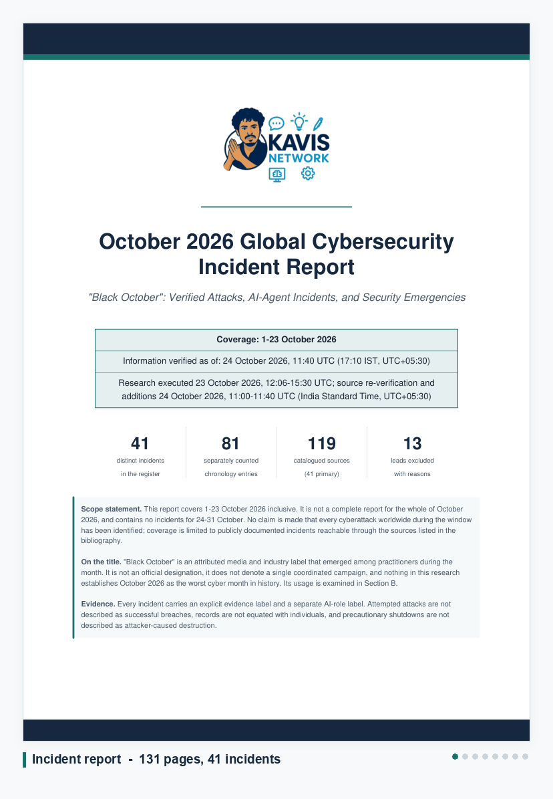

# Black October 2026

Research documentation on worldwide cybersecurity incidents, security emergencies and AI-agent
incidents recorded between **1 and 23 October 2026**, with a separate evidence file carrying the
source record behind the headline claims.

Published by **Kavis Network**.

  

Pages from the two documents in this repository. Frames are rendered directly from the published PDFs.

---

## Contents

| File | Description |
|---|---|
| [`Kavis_Network_October_2026_Global_Cyber_Incident_Report.pdf`](Kavis_Network_October_2026_Global_Cyber_Incident_Report.pdf) | Full incident report. 131 pages. 41 incidents, day-by-day chronology, detailed profiles, AI-agent analysis, supply-chain mapping, corrections and a complete bibliography. |
| [`evidence.pdf`](evidence.pdf) | Evidence file. 19 pages, 11 claim-by-claim records across 17 sources. For each claim: what the sources establish, verbatim quotations, and what the sources do **not** establish. |
| [`October_2026_Incident_Register.csv`](October_2026_Incident_Register.csv) | The incident register as structured data. 44 rows, 31 columns, including dates, evidence labels, AI-role labels, attribution confidence, quantitative claims, unknowns and source URLs. |

---

## Scope

Coverage is **1–23 October 2026 inclusive**. This is deliberately not presented as a complete
report for the whole month, and it contains no incidents for 24–31 October. No claim is made that
every cyberattack worldwide in the window has been identified — coverage is limited to publicly
documented incidents reachable through the sources listed in each document's bibliography.

Incidents are separated into four categories:

- **A** — occurred during 1–23 October 2026
- **B** — earlier incident first publicly disclosed during October
- **C** — earlier incident with substantial new October developments
- **D** — historical background, held in an appendix and excluded from all October totals

For every incident the attack window, detection date, first disclosure date and latest verified
update are recorded separately. Where a date could not be established it is marked `Unknown`
rather than inferred, and an article's publication date is never substituted for an attack date.

---

## On the name

"Black October" is an **attributed media and industry label** that emerged among practitioners
during the month. It is not an official designation, it does not describe a single coordinated
campaign, and nothing in this research establishes October 2026 as the worst cyber month in
history. Its usage is examined in the report rather than adopted.

Several of the documented incidents began well before October: Microsoft describes Storm-0940
activity from September 2026, and the LiteLLM compromise traces to a key exposed on 27 May 2026.

---

## Evidence standards

Every incident carries an explicit **evidence label** and a separate **AI-role label**, so that
confidence in an incident's facts is never conflated with confidence in an AI claim about it.

**Evidence labels**

| Label | Meaning |
|---|---|
| `CONF` | Confirmed by affected organisation or authority |
| `RESEARCH` | Researcher-observed / researcher-assessed |
| `CRED` | Credibly reported, not independently confirmed |
| `SUSP` | Suspected exposure; investigation ongoing |
| `CLAIM` | Attacker claim only |
| `DISP` | Disputed or corrected |
| `VULN` | Vulnerability emergency without established victim compromise |

**AI-role labels**

| Label | Meaning |
|---|---|
| `AI-SUB` | AI use substantiated |
| `AI-SUS` | AI use suspected |
| `AI-AFF` | AI system affected, but AI use by attacker unproven |
| `AI-NONE` | No demonstrated AI involvement |

### Distinctions held throughout

- A targeted organisation is not a compromised organisation.
- An exploitation attempt is not a successful exploitation.
- A record count is not a count of distinct people.
- A published vulnerability is not a breach.
- A precautionary shutdown is not attacker-caused destruction.
- Distribution of a malicious package is not infection of every user of that product.
- A Chinese-language operator is not a Chinese state actor.
- A service returning online is not complete security recovery.
- A vendor's assessment of a state actor is that vendor's assessment, not an established fact.
- General security guidance is not evidence about the cause of any specific incident.

Downstream victims of a supply-chain incident are linked to the parent incident rather than
counted as separate intrusions. Incompatible metrics are never summed; conflicting figures are
reported side by side with their bases.

---

## Known limitations

These are stated in full inside each document, and summarised here.

- Research was conducted in a short window, predominantly through English-language sources with
  some Japanese-language material.
- A number of sources were inaccessible (HTTP 403, unreachable domains, timeouts, or
  subscription limits). Each is individually marked with what was and was not read. No source is
  represented as read when it was not.
- Regional coverage is uneven. Japan, North America and Western Europe are well covered. The
  Middle East, Southeast Asia and Central Asia have no verified entries at all — that is a
  coverage failure, not a finding about those regions.
- Several leads named during research are excluded entirely for want of a retrievable dated
  source, which means the register understates some clusters.
- Incidents sourced from aggregator trackers are labelled `CRED` and were not confirmed against
  company or institutional notices.

Corrections and disputed claims are carried in a dedicated section rather than a footnote,
including figures that were revised upward, attacker claims that affected organisations publicly
rejected, and at least one root-cause account that a vendor later superseded.

---

## Research conduct

Public reporting only. No victim systems were scanned or probed, no exploits were tested or
developed, no leaked datasets were accessed, and no exposed credentials were retrieved. No
authentication was bypassed and no paywall circumvented; access errors were recorded and
accessible alternatives sought instead. No secret value is reproduced in any document here.

---

## Using this material

If you cite these documents, please carry the evidence label with the claim. A figure labelled
`CLAIM` or `SUSP` loses its meaning the moment it is quoted without that qualifier, and several of
the largest numbers circulating about this period are attacker claims that the affected
organisations disputed.

Incident pages for live investigations should be re-checked before relying on recovery or scope
statements, which are accurate only as of the timestamps recorded in the documents.
